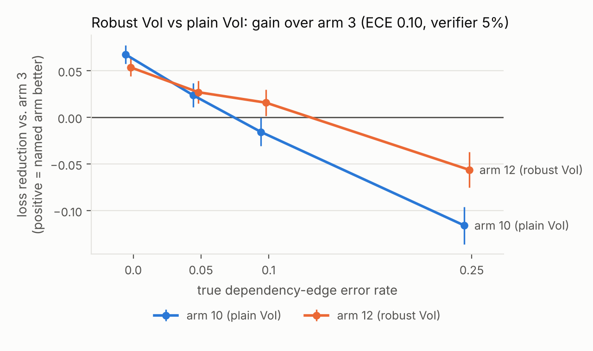

# Burhava

**Which step of a reasoning chain should you verify?** Burhava studies verification selection for LLM reasoning chains. Each candidate check is scored by how much it is expected to reduce the *loss of the final decision* (accept / reject / abstain), divided by its cost. This is classical **Value of Information** (Howard 1966; Krause & Guestrin 2009), and we do not claim the rule is new. We test empirically, under a pre-registered protocol, whether it beats confidence-based selection and whether the advantage survives realistic estimation noise.

## Summary
Two pre-registered phases, 24,960,000 simulated verification episodes (counted from the result files), every number with a 95% CI ([RESULTS](docs/RESULTS.md)):

1. **Using the dependency graph to choose checks beats "check the least confident premise"**, in every graph structure. In mixed graphs at budget 2 the loss drops by 0.11, and the gain grows with the false-rate and with the cost of a false accept.
2. **It survives miscalibrated confidences** (ECE up to 0.20) and noisy verifiers (5–15%).
3. **Making the *selection* decision-aware (VoI) adds nothing measurable** over a simple loss-blind influence score, confirmed on fresh data (H6c) and across loss ratios 1–30. What matters is graph-aware selection plus a loss-aware *final decision*.
4. **Stopping early hurts.** "VoI then spend the budget" fixes this (budget-5 loss 0.089 → 0.077).
5. **Wrong dependency edges are the real danger.** At ≥ 5% edge error every graph-based method loses its edge, and at 25% it is worse than not verifying. Our robust variant (averaging over plausible graphs) keeps the gain up to about 10% edge error. Beyond that, plain self-consistency is best.
6. Modelling correlated sources barely matters (H3 rejected).
7. **Real-LLM results (Stage C) are not in yet.** The pipeline is built and tested offline. It is waiting for an API budget and a working key.

**Rule of thumb:** measure how well you recover the reasoning graph first. Below ~2% edge error, use the graph to choose checks and spend the whole budget. Between ~5% and 10%, use the robust variant or self-consistency. Above 10%, use self-consistency.

## Results
| ID | Hypothesis | Verdict | Key number (95% CI) |
|---|---|---|---|
| H1 | Arm 10 < arm 3 in loss (Stage A) | ✅ 4/4 structures | mixed graphs: +0.112 [+0.107, +0.116] |
| H2 | Lookahead helps on AND | ✅ (small) | +0.0041 [+0.0036, +0.0046] |
| H3 | Modelling correlation matters | ❌ | 4.1% of the gain (needed ≥ 5%) |
| H4 | Survives ECE 0.10 + verifier 5% | ✅ | +0.065 [+0.052, +0.078] |
| H5 | Transfers to ProofWriter/PrOntoQA | ⏸ not run | API budget pending |
| H6a | VoI-then-spend beats VoI (budgets 3–5) | ✅ | +0.0071 [+0.0065, +0.0078] |
| H6c | Decision-aware selection beats the influence score | ❌ | +0.0000 [−0.0003, +0.0003] |
| H7a | Robust VoI beats VoI at 10% edge error | ✅ | +0.031 [+0.022, +0.041] |
| H7d | Robust VoI not harmful at 25% edge error | ❌ | −0.104 vs no verification |




## Quickstart
```bash
make setup
```
```bash
make test
```
```bash
make reproduce-small
```
`reproduce-small` takes about 1 minute (51 s measured) and checks the pipeline. `make reproduce-full` re-runs the pre-registered experiments in about 45 minutes on 4 cores: Stage A 20 min plus its 9-min report, loss sweep 3 min, Stage B 11 min plus its 2-min report.

```python
from burhava import AssumptionGraph, Problem, Loss, set_risk, marginal_value

g = AssumptionGraph()
g.add_atom("Z1", 0.90)
g.add_atom("Z2", 0.60)
g.add_atom("Z3", 0.55)
g.add_or("Z2orZ3", ["Z2", "Z3"])
g.add_and("Y", ["Z1", "Z2orZ3"])
g.set_conclusion("Y")
b = Problem(g).prior_belief()
L = Loss.from_costs(false_accept=10, false_reject=1, abstain=0.6)
print(set_risk(b, L), [marginal_value(b, L, [], i) for i in range(3)])  # 0.6 [0.06, 0.042, 0.027]
```

## What this is not
* **Not a new decision principle.** The rule is VoI; the contribution is the empirical test and its boundaries.
* **Not evidence about real LLMs yet.** Stages A and B are synthetic.
* **Not scalable inference.** Exact enumeration over 2^n states, n ≤ 20.

## Layout
`src/burhava/`: `graph`, `model`, `risk` (exact engine) · `policies` (10 arms) · `simulate` (paired episodes) · `generators`, `noise`, `runner`, `stage_b`, `analysis`, `stats` · `llm/` (Stage C, offline) · `cli`.

## Docs
[Research brief](docs/RESEARCH_BRIEF.md) · [Math](docs/MATH.md) · [Pre-registration](docs/PREREGISTRATION.md) · [Pre-registration 2](docs/PREREGISTRATION_2.md) · [Results](docs/RESULTS.md) · [Experiments](docs/EXPERIMENTS.md) · [Decisions](docs/DECISIONS.md) · [Related work](docs/RELATED_WORK.md) · [Paper skeleton](paper/main.tex)
