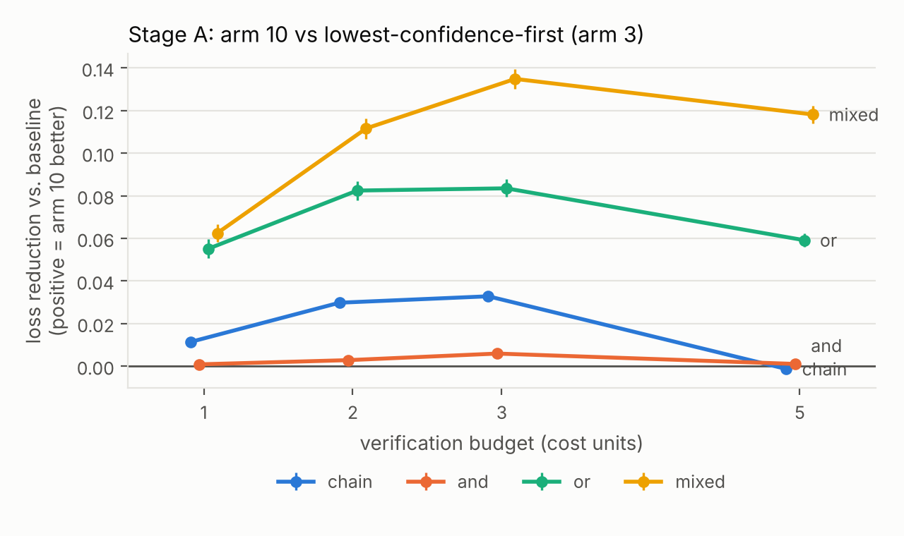
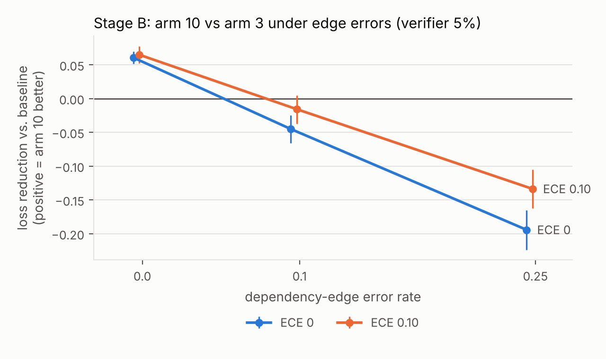

# Burhava

**Which step of a reasoning chain should you verify?** Burhava studies verification selection for LLM reasoning chains. Each candidate check is scored by how much it is expected to reduce the *loss of the final decision* (accept / reject / abstain), divided by its cost. This is classical **Value of Information** (Howard 1966; Krause & Guestrin 2009), and we do not claim the rule is new. We test empirically, under a pre-registered protocol, whether it beats confidence-based selection and whether the advantage survives realistic estimation noise.

## Honest summary
* **On synthetic chains with a correct model**, VoI with lookahead (arm 10) clearly beats "check the least confident premise" (arm 3) in all four graph structures. The gain is large on mixed and OR graphs, tiny on pure-AND graphs, and grows with the false-rate and with the cost of a false accept.
* **It survives miscalibrated probabilities** (ECE up to 0.20) and noisy verifiers (5–15%).
* **But two caveats dominate:**
  1. A simple loss-blind "how much would this premise move P(conclusion)" score does just as well at budgets 1–2, and better at budgets 3–5 in almost every cell. The win comes mostly from *using the dependency graph*, not from decision-awareness. (This was exploratory, not pre-registered.)
  2. Everything graph-based collapses once ≳ 5% of dependency edges are wrong. At 10% it is worse than confidence-based selection, and at 25% worse than not verifying.
* Modelling correlated sources barely matters (H3 rejected).
* **Real-LLM results (Stage C) are not in yet:** they are waiting for an API budget decision.

## Results
| ID | Hypothesis | Verdict | Key number (95% CI) |
|---|---|---|---|
| H1 | Arm 10 < arm 3 in loss (Stage A) | ✅ supported, 4/4 structures | mixed graphs: +0.112 [+0.107, +0.116] |
| H2 | Lookahead helps on AND | ✅ supported (small) | +0.0041 [+0.0036, +0.0046] |
| H3 | Modelling correlation matters | ❌ rejected | 4.1% of the gain (needed ≥ 5%) |
| H4 | Survives ECE 0.10 + verifier 5% | ✅ supported | +0.065 [+0.052, +0.078] (84% of clean) |
| H5 | Transfers to ProofWriter/PrOntoQA | ⏸ not run | API budget pending |

Details, all numbers and sources: [docs/RESULTS.md](docs/RESULTS.md). Every run is logged in [docs/EXPERIMENTS.md](docs/EXPERIMENTS.md).




## Quickstart
```bash
make setup
```
```bash
make test
```
```bash
make reproduce-small
```
`reproduce-small` takes about 1 minute (51 s measured) and checks the pipeline. `make reproduce-full` re-runs the pre-registered experiments in about 45 minutes on 4 cores: Stage A 20 min plus its 9-min report, loss sweep 3 min, Stage B 11 min plus its 2-min report.

```python
from burhava import AssumptionGraph, Problem, Loss, set_risk, marginal_value

g = AssumptionGraph()
g.add_atom("Z1", 0.90)
g.add_atom("Z2", 0.60)
g.add_atom("Z3", 0.55)
g.add_or("Z2orZ3", ["Z2", "Z3"])
g.add_and("Y", ["Z1", "Z2orZ3"])
g.set_conclusion("Y")
b = Problem(g).prior_belief()
L = Loss.from_costs(false_accept=10, false_reject=1, abstain=0.6)
print(set_risk(b, L), [marginal_value(b, L, [], i) for i in range(3)])  # 0.6 [0.06, 0.042, 0.027]
```

## What this is not
* **Not a new decision principle.** The rule is VoI; the contribution is the empirical test and its boundaries.
* **Not evidence about real LLMs yet.** Stages A and B are synthetic.
* **Not scalable inference.** Exact enumeration over 2^n states, n ≤ 20.

## Layout
`src/burhava/`: `graph`, `model`, `risk` (exact engine) · `policies` (10 arms) · `simulate` (paired episodes) · `generators`, `noise`, `runner`, `stage_b`, `analysis`, `stats` · `llm/` (Stage C, offline) · `cli`.

## Docs
[Research brief](docs/RESEARCH_BRIEF.md) · [Math](docs/MATH.md) · [Pre-registration](docs/PREREGISTRATION.md) · [Results](docs/RESULTS.md) · [Experiments](docs/EXPERIMENTS.md) · [Decisions](docs/DECISIONS.md) · [Related work](docs/RELATED_WORK.md) · [Paper skeleton](paper/main.tex)
