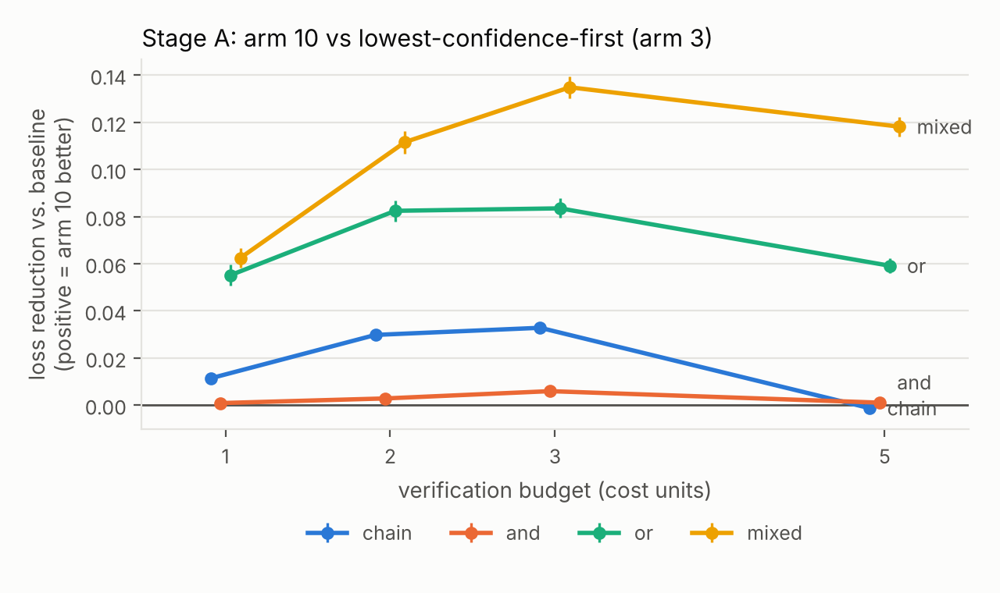
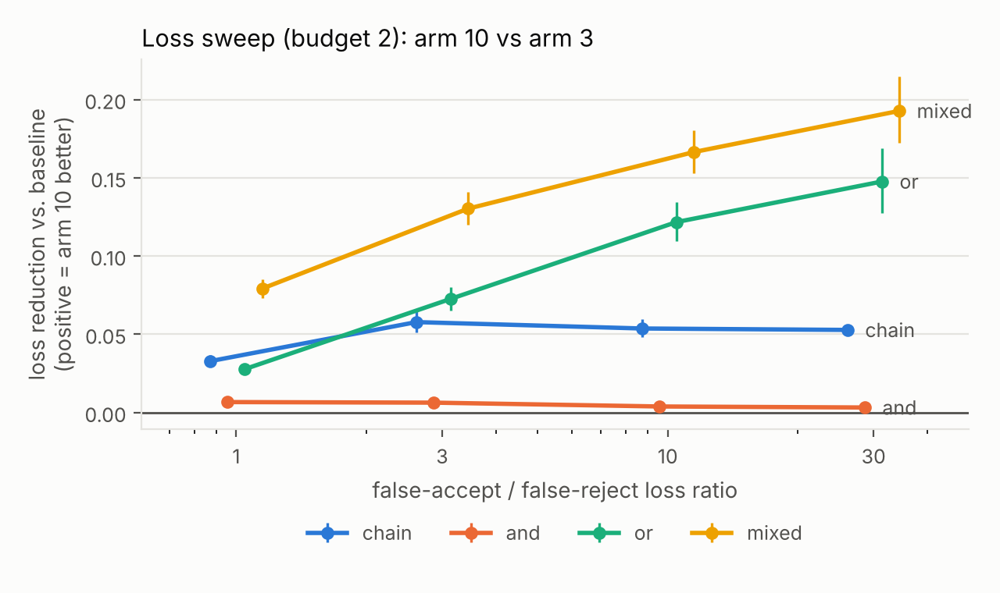
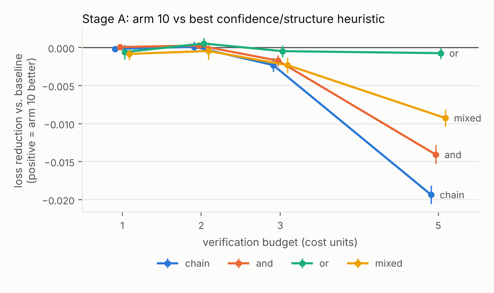
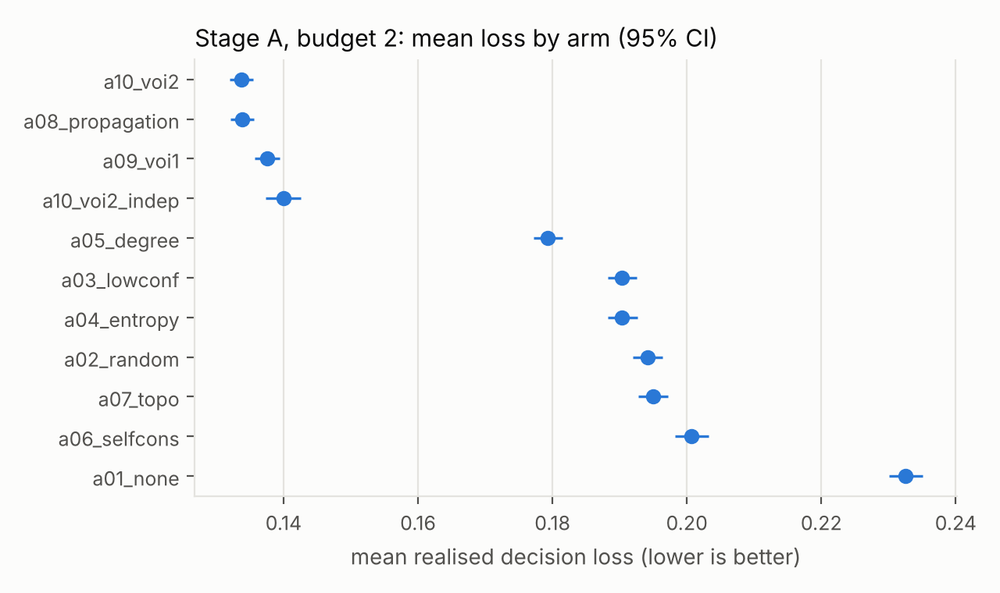
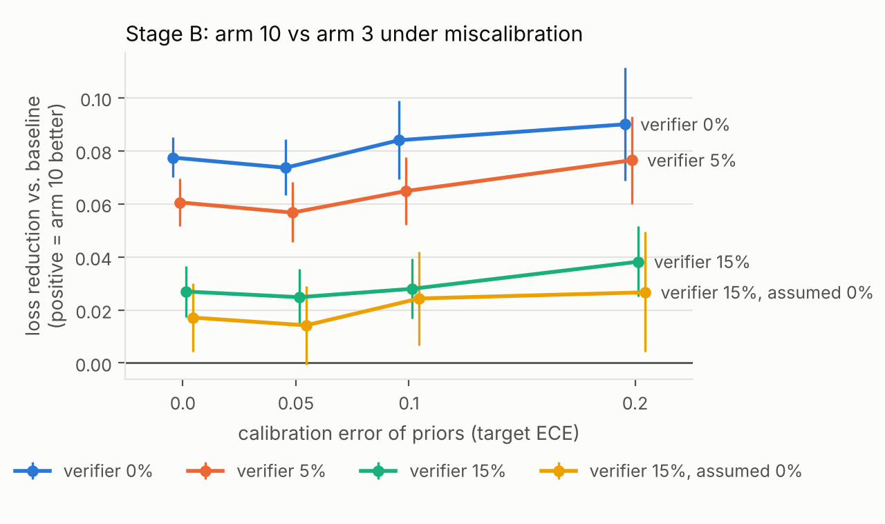
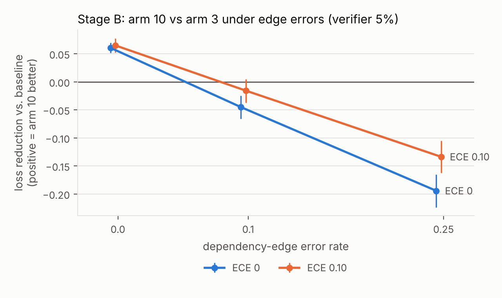

# Results

Every number on this page comes from `results/summaries/*.json`, produced by the commands listed in [EXPERIMENTS.md](EXPERIMENTS.md).
* **Gain** means `loss(baseline) − loss(arm 10)` per instance, averaged; positive means arm 10 is better.
* **Brackets** are 95% paired bootstrap CIs (10,000 resamples).
* **Loss** is false-accept 10, false-reject 1, abstain 0.6, unless stated otherwise.

## Verdicts at a glance

| ID | Hypothesis | Verdict | Key number | Run |
|---|---|---|---|---|
| H1 | Arm 10 beats lowest-confidence-first (arm 3), Stage A | ✅ **supported** (0 of 4 structures fail) | mixed +0.112 [+0.107, +0.116] | M3-A |
| H2 | Lookahead (arm 10) beats one-step VoI (arm 9) on AND | ✅ **supported**, small | +0.0041 [+0.0036, +0.0046] | M3-A |
| H3 | Modelling correlation matters | ❌ **rejected** | ignoring it costs 4.1% of the gain (threshold 5%) | M3-A |
| H4 | Advantage survives ECE 0.10 + verifier 5% | ✅ **supported** | +0.065 [+0.052, +0.078], 84% of clean | M4-B |
| H5 | Advantage transfers to ProofWriter/PrOntoQA | ⏸ **not run** | waiting for API budget approval | M5 |

Gate 1 (H1) passed. Gate 2 (H4) passed.

## H1: Stage A, budget 2, arm 10 vs arm 3
`results/summaries/stageA_summary.json` → `H1`. n = 64,000 instances per structure.

| Structure | Gain | 95% CI | Layered generator | Rules generator |
|---|---|---|---|---|
| chain | +0.0298 | [+0.0277, +0.0319] | +0.0001 [−0.0006, +0.0008] | +0.0594 [+0.0553, +0.0637] |
| and | +0.0028 | [+0.0022, +0.0035] | +0.0016 [+0.0010, +0.0023] | +0.0040 [+0.0028, +0.0050] |
| or | +0.0824 | [+0.0778, +0.0869] | +0.0113 [+0.0079, +0.0151] | +0.1536 [+0.1454, +0.1618] |
| mixed | +0.1116 | [+0.1068, +0.1162] | +0.1055 [+0.0984, +0.1126] | +0.1177 [+0.1113, +0.1243] |

How to read this:
* The effect is large in mixed and OR graphs, tiny in pure-AND graphs, and in "chain" it comes entirely from the rules generator.
* The gain grows with the false-rate: +0.003 at f=0, then +0.060, +0.077 and +0.088 at f = 0.1, 0.2, 0.3.
* It does not change with depth (+0.053 to +0.058).
* With varied costs it is a little smaller than with uniform costs, so the gain is **not** mainly cost-awareness.

**Loss sweep** (`stageA_loss_summary.json`): the gain grows with the false-accept/false-reject ratio in OR and mixed graphs (mixed: +0.079 at ratio 1 → +0.193 at ratio 30). It is flat in chain graphs and small in AND graphs.

## Important exploratory finding (not pre-registered)
**A loss-blind "propagation score" (arm 8) does as well as arm 10.** Arm 8 checks the atom whose truth would move P(Y) the most, ignoring loss and cost.

At budget 2, mean losses are: arm 10 0.1337, arm 8 0.1338, arm 9 0.1375, arm 3 0.1903, no verification 0.2325.

At budgets 3–5, arm 8 is *better* than arm 10 in every structure except OR at budget 3, where the difference is not significant (chain, budget 5: by 0.019 [0.018, 0.021]). The reason is that arm 10 stops verifying once no single check or pair has positive value, while arm 8 spends the whole budget.

**Plain reading:** the big win over confidence-based selection comes from *using the dependency graph and the probabilities*. Being decision-aware adds little on top in these synthetic worlds, and VoI's early stopping costs accuracy when the budget is free.

## H2: lookahead on AND graphs
Arm 10 vs arm 9, budgets 2–3, pure AND: **+0.0041 [+0.0036, +0.0046]**. It is significant but small: lookahead fixes the stall of §5.1 in MATH.md, which is rare in random graphs.

## H3: correlation modelling
In shared-source cells, arm 10 run with an independence model loses **+0.0020 [+0.0016, +0.0025]** relative to arm 10 with the correct model. That is **4.1%** of the H1 gain in those cells (+0.0496). The difference is real but below the pre-registered 5% bar, so **H3 is rejected**.

## H4: noise robustness (Stage B)
`results/summaries/stageB_summary.json`. Depth 4, budget 2, 500 graphs per cell.

* Clean: **+0.0775 [+0.0701, +0.0852]**.
* ECE 0.10 with verifier 5% (matched): **+0.0648 [+0.0522, +0.0775]**, which is 84% of clean. **H4 is supported.** The pure-AND structure is n.s. at this point: +0.001 [−0.001, +0.004].
* Achieved ECE was 0.046, 0.092 and 0.189 for targets 0.05, 0.10 and 0.20.
* The gain stays positive at every calibration level up to ECE 0.20 and at verifier error 15%. With verifier 15% and a mismatched assumption (the method thinks it is perfect), the gain is smaller (+0.014 to +0.027) and one cell is n.s.

### The boundary: dependency-edge errors
| Edge error | Gain over arm 3 (verifier 5%, ECE 0) | Source |
|---|---|---|
| 0% | +0.052 [+0.040, +0.063] | exploratory run M4-E |
| 2% | +0.034 [+0.020, +0.048] | M4-E |
| 5% | −0.005 [−0.023, +0.013] | M4-E |
| 10% | −0.045 [−0.066, −0.025] | pre-registered grid M4-B |
| 25% | −0.194 [−0.224, −0.165] | M4-B |

At 25% edge error, every graph-based arm (8, 9, 10) does worse than not verifying at all. Its model claims a risk of about 0.2 while the realised loss is about 0.53. **Risk-aware verification pays only when the dependency graph is recovered with ≲ 2–5% edge error.**

## H5: Stage C
Not run. See DECISIONS.md D23 for the cost estimate, the blocked credential and the open design question. Stage B predicts that H5 hinges on dependency-recovery F1.

## Limitations
* Synthetic priors and structures. Generator A's OR graphs have P(Y)≈1.
* Exact enumeration limits graphs to 14 atoms in these experiments (20 in the engine).
* The verifier errors are independent given the truth.
* The self-consistency arm is modelled generously (independent samples).
* The exploratory edge grid was added after seeing the pre-registered edge results. It is labelled as exploratory and uses a fresh seed.
